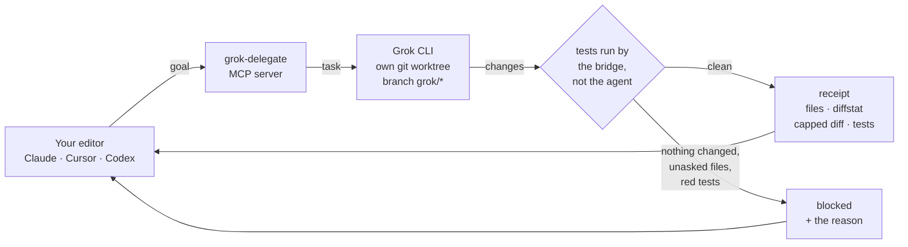

# grok-delegate

[English](README.md) · [Русский](README.ru.md)

**Hand the coding loop to Grok CLI. Your host reads a receipt, not a repository.**

> MCP server that delegates coding tasks from Claude Code, Cursor or Codex to the local Grok CLI in an isolated git worktree and returns a verified receipt (diffstat, capped diff, test results). Unofficial.

[](https://github.com/zai-one/grok-build-mcp/actions/workflows/tests.yml)
[](https://www.python.org/downloads/)
[](LICENSE)
[](https://modelcontextprotocol.io/)
[](pyproject.toml)
[](https://zai.one)

> By [ZAI.ONE](https://zai.one), a digital agency for websites, SEO, advertising and analytics.

Claude Code, Cursor and Codex spend most of their context on the cheapest part
of the work: the edit → run tests → read output → fix loop. `grok-delegate` is
an MCP server that hands that loop to **Grok CLI** on your own machine, in a git
worktree of its own, and gives your host back a bounded receipt — changed files,
diffstat, a capped diff, and test results.



The receipt keeps the host focused on changed files, test results and a capped
diff. It limits how much job output enters the host context; it does not promise
a fixed token saving for every task. See [receipt behavior](docs/economy.md).

## Is this for you

**Yes** — you drive Claude Code, Cursor or Codex every day, you have a Grok CLI
session, and you have noticed that most of what your editor reads is output it
produced itself. Doubly so across several repositories, on a plan you watch.

**No** — you have no Grok CLI login. The bridge carries no credentials of its
own and cannot work without one. Also no if you want an agent that merges its
own work: this one commits to a `grok/*` branch and stops there, on purpose.

## Why this MCP

- Optional lazy tool loading: set `GROK_DELEGATE_TOOL_LOADING=lazy` (or choose it in the setup wizard) to start with a small core and enable toolsets on demand; see [Lazy tool loading](#lazy-tool-loading).
- Tests are run by the bridge, not by the agent; empty changes, unrequested files or red tests come back as `blocked` with a reason.
- The host reads a bounded receipt instead of the repository, which keeps its context small.
- 24 tools, 2 prompts, a resource, skills and a Claude Code plugin; `uvx` and one-command installers for Linux, macOS and Windows.
- Other Grok MCP servers on GitHub wrap the xAI API ([djtelicloud/grok-mcp-server](https://github.com/djtelicloud/grok-mcp-server)) or pass prompts to the CLI ([BasisSetVentures/grok-cli-mcp](https://github.com/BasisSetVentures/grok-cli-mcp), 3 tools); neither isolates work in a worktree or verifies tests.

## Lazy tool loading

Optional lazy tool loading: `GROK_DELEGATE_TOOL_LOADING=lazy` starts with a small core plus `grok_agent_enable_toolsets` and adds toolsets on demand (`tools/list_changed`). Startup cost (tools/list + instructions, ≈chars/4): eager ≈7466 tokens, lazy ≈1672 tokens (−78%). Default `eager` is unchanged; if your client ignores `tools/list_changed`, keep `eager` or reconnect after enabling. Scope: enablement is process-wide (this JSON-RPC server has no per-session tool visibility). Over stdio that is one client; in shared HTTP mode one client's enabled toolsets are listed for every client of that process (each call still passes its own gates), so use `eager` for shared HTTP.

Clients and `notifications/tools/list_changed` (verified against official docs, changelogs or maintainer statements, 2026-10):

| Client | `tools/list_changed` | Source |
|---|---|---|
| Claude Code | Supported (interactive: tools, prompts, resources; `-p`/Agent SDK: tools) | [docs: Dynamic tool updates](https://code.claude.com/docs/en/mcp) |
| VS Code (GitHub Copilot) | Supported (dynamic tool discovery); new tools may reach the agent only on the next turn | [docs](https://code.visualstudio.com/api/extension-guides/ai/mcp), [#303012](https://github.com/microsoft/vscode/issues/303012) |
| Gemini CLI | Supported (refreshes the tool registry) | [PR #14375](https://github.com/google-gemini/gemini-cli/pull/14375), [PR #21050](https://github.com/google-gemini/gemini-cli/pull/21050) |
| Cursor | Unreliable: staff confirm a regression in 3.12.x; restart Cursor after enabling | [forum](https://forum.cursor.com/t/mcp-server-regression-does-not-reload-tools-disconnect-does-nothing-ignores-mcp-json-changes-etc/166216) |
| Claude Desktop, Windsurf, Codex CLI, Cline, Zed, Continue | Unverified: no official statement found; use `eager` or reconnect after enabling | — |

## Maintained and up to date

- Actively maintained by ZAI.ONE: current version 0.35.0; release notes in [CHANGELOG.md](CHANGELOG.md) and [Releases](https://github.com/zai-one/grok-build-mcp/releases).
- Built-in update check: ask the assistant to run `grok_agent_check_update` (public GitHub API, no credentials, cached; nothing is installed automatically; `GROK_DELEGATE_DISABLE_UPDATE_CHECK=1` turns it off).
- Follows current MCP practice: tool annotations (read-only / destructive hints), server `instructions`, prompts and resources, structured errors with recovery hints, secrets kept out of tool output, a token budget for tool descriptions enforced in tests.
- CI runs the test suite on Linux and Windows for every pull request.

## Give this to your assistant

The shortest way in is to let the editor install it. Paste this into Claude
Code, Cursor or Codex, opened in the repository you want to delegate from:

```text
Install the grok-delegate MCP bridge from https://github.com/zai-one/grok-build-mcp
into this project. Read its README and docs/EASY.md first, run the installer for
my platform from the Install section, create .grok-mcp.json with preset
"standard", then call grok_agent_status and show me what it reports. Auth is
`grok login` only — never put an API key or OAuth token in the MCP config.
```

Your host supplies the project directory itself if it speaks MCP `roots`, so
there is usually no environment variable to set and nothing to restart.

Reading this as an agent, not a person? [`AGENTS.md`](AGENTS.md) is the rulebook,
[`docs/EASY.md`](docs/EASY.md) the install path,
[`skills/grok-mcp`](skills/grok-mcp) a router skill for Claude/Cursor/Codex, and
[`schemas/`](schemas/) the tool schemas. Tools are discovered over MCP
`tools/list` — nothing here needs scraping.

## Why the receipt is worth trusting

Delegation is only cheaper if you can believe the result without re-reading
everything. Four things make that true here:

- **The bridge runs your tests — the worker does not get to grade itself.**
  Anything the agent says about its own tests is labelled `agent-reported` and
  is not evidence. A live capture once caught an agent reporting exit code 0
  while pytest was failing: in a shell, `a; b` returns *b*'s exit code.
- **A job that changed nothing comes back `no_changes`, and one that touched
  files you never asked for comes back `blocked`,** with the reason, instead of
  `ok` and a cheerful summary. The two are different answers because they are
  different situations: nothing happened, or something happened that nobody
  asked for. An artifact written by the test run rather than by the worker is
  caught too.
- **It never pushes and never merges.** Work lands on a `grok/*` branch, which
  the bridge commits for you even if the worker ran out of turns. You review it.
- **It fails closed.** Nothing is in scope until a root is granted, and every
  project stays off until it carries a `.grok-mcp.json` of its own. A root is
  never granted by a tool call — it comes from the directory *you* opened.

Nothing is pinned, deliberately: no hardcoded model, no pinned Grok CLI build.
An upstream upgrade reaches you without waiting for a release here.

## It works in the host you already use

The bridge asks your editor which folder you have open, over MCP `roots/list`,
and works there. No environment variable, no restart, no per-project setup —
open a different project and the scope follows; close it and the scope narrows.

That is not a convenience shortcut around the allowlist, it is the protocol's
own answer to the question. A root arrives because a person opened that
directory; an agent cannot name one, and `GROK_DELEGATE_ALLOWED_ROOTS` still
works and still wins where you want the list written down. If you would rather
the host had no say at all, `GROK_DELEGATE_MCP_ROOTS=0` refuses it.

Hosts without `roots` support fall back to the environment variable, and the
refusal says which of those situations you are in rather than printing the same
sentence at everyone.

## Requirements

Python 3.10+, git, and **Grok CLI installed and logged in** (`grok login`) as the
same OS user that runs the bridge. Auth stays with the CLI — this server never
reads your credentials, and no OAuth or API key ever belongs in an MCP config.
Zero runtime dependencies otherwise.

> **Unofficial community project** — not xAI, Grok, Anthropic, or OpenAI.

---

## Install (one command)

```bash
curl -fsSL https://raw.githubusercontent.com/zai-one/grok-build-mcp/main/scripts/install.sh \
  | bash -s -- --project "$HOME/code/my-project"
```

Windows (name the project — the default is your whole user profile):

```powershell
& ([scriptblock]::Create((irm https://raw.githubusercontent.com/zai-one/grok-build-mcp/main/scripts/install.ps1))) -Project "$env:USERPROFILE\code\my-project"
```

Then, on macOS/Linux:

```bash
grok login
~/.local/share/grok-mcp/.venv/bin/python -m grok_delegate --self-test
```

On Windows the installer puts the checkout in `%LOCALAPPDATA%\grok-mcp`:

```powershell
grok login
& "$env:LOCALAPPDATA\grok-mcp\.venv\Scripts\python.exe" -m grok_delegate --self-test
```

Merge `~/.config/grok-mcp/mcp/claude_desktop.snippet.json` into Claude/Cursor → restart → `grok_agent_status`.

## Install as a plugin or via uvx

```bash
# Claude Code: MCP only
claude mcp add grok-mcp -- uvx --from git+https://github.com/zai-one/grok-build-mcp@v0.35.0 grok-delegate
# Claude Code: plugin = MCP + grok-mcp skill
/plugin marketplace add zai-one/grok-build-mcp
/plugin install grok-mcp@grok-build-mcp
```

Cursor: [one-click install](cursor://anysphere.cursor-deeplink/mcp/install?name=grok-mcp&config=eyJjb21tYW5kIjoidXZ4IiwiYXJncyI6WyItLWZyb20iLCJnaXQraHR0cHM6Ly9naXRodWIuY29tL3phaS1vbmUvZ3Jvay1idWlsZC1tY3BAdjAuMzUuMCIsImdyb2stZGVsZWdhdGUiXX0=) or `.cursor/mcp.json`:

```json
{"mcpServers": {"grok-mcp": {"command": "uvx", "args": ["--from", "git+https://github.com/zai-one/grok-build-mcp@v0.35.0", "grok-delegate"]}}}
```

Codex `~/.codex/config.toml`:

```toml
[mcp_servers.grok-mcp]
command = "uvx"
args = ["--from", "git+https://github.com/zai-one/grok-build-mcp@v0.35.0", "grok-delegate"]
```

Claude Desktop: the same `mcpServers` block in `claude_desktop_config.json`. The skill ships in `skills/grok-mcp/` (mirrored for Claude Code, Cursor, Codex in `.claude/`, `.cursor/`, `.codex/`, `.agents/`). Projects are allowed through the roots your host declares or `GROK_DELEGATE_ALLOWED_ROOTS`. Run `grok login` first. Prompts: `delegate_task`, `review_diff`; guides: `grok://guide/index`.

Example asks: "Delegate to Grok: add retries to the HTTP client, tests must pass", "Ask Grok to review the last job", "Is grok-mcp healthy?", "Enable grok-mcp for this project with the cheap preset", "Check for a grok-mcp update".

## Host loop

Once it is wired, use this loop:

1. `grok_agent_session_begin({"goal":"…","host_budget":"small"})`
2. Loop `grok_agent_session_next` → execute only the `card` it hands you
   (`host_cmd` | `mcp_tool` | `end`)
3. Stop polling when `done=true`.
4. Finish with `grok_agent_session_end`.

The **`grok-mcp`** skill enforces this shape, so a host that loads it does not
have to be told twice. Execute cards carry a full `task`; a poll card is
`{job_id}` and nothing else. If a card ever fails schema validation, the typed
tools — consult → execute → poll → review — take the same packet.


### Claude Code, on this repository

A project-scoped [`.mcp.json`](.mcp.json) ships in the repo, so opening it in Claude
Code wires `grok-delegate` with no install step — the package has no runtime
dependencies. The entry resolves the package from `CLAUDE_PROJECT_DIR`, which Claude
Code sets in the server's environment, so it does not depend on the working directory
the host happens to use.

The command defaults to the Windows `py` launcher. Elsewhere, point it at your
interpreter:

```bash
export GROK_MCP_PYTHON=python3
```

This path skips the installer, so nothing writes the env file for you. Claude
Code declares its workspace over MCP `roots`, so the project you have open is
granted without any of that. The variables below are for a host that does not,
or for granting a directory you have not opened:

```bash
export GROK_DELEGATE_ALLOWED_ROOTS=/path/to/project   # ';' separates several
export GROK_DELEGATE_LANES_PARENT=/path/to/.grok-mcp-lanes
```

Unset, lanes go to **`<project>/.grok/lanes/<slug>`** — inside the project they
belong to, under a dot-directory the bridge adds to `.gitignore` on first use.
A lane holds unmerged work someone will review, so it lives with the work rather
than in a sibling directory nobody asked for. The dot is what keeps it out of the
way: pytest skips `.*`, ripgrep and indexers skip hidden, git is told once.

`GROK_DELEGATE_LANES_PARENT` still overrides it, and a path in the *visible*
source tree is still refused — tools walk that. The receipt's `worktree_path` is
always the honest answer.

Set them where the host will inherit them, then restart it. `grok_agent_status`
reports what was actually granted under `roots.allowed`. A child of an
allowlisted root is not implicitly trusted.

### Letting the host grant the current project

Maintaining that list by hand gets old once you work across several projects.
The host already knows which directory you opened — Claude Code exports it to
the server as `CLAUDE_PROJECT_DIR` — so the server can take the allowlist from
there:

```bash
export GROK_DELEGATE_TRUST_HOST_ROOTS=1
```

With it set, the directory the session was launched in joins the allowlist and
no longer needs to be listed. It **widens** the list rather than replacing it:
anything in `GROK_DELEGATE_ALLOWED_ROOTS` stays granted, and exact-equality
membership is unchanged — a sibling or a child of the session directory is still
refused.

Off by default, and deliberately. Granting a root because the host named it
means the operator's explicit list is no longer the whole answer; that is a fair
trade when the host is your own editor, but it is yours to make. `grok_agent_status`
shows `roots.host_root_trusted` and `roots.host_root` so a root you never typed
is traceable.

Hosts that do not set `CLAUDE_PROJECT_DIR` are unaffected — the flag then grants
nothing.

That environment variable is now the second-best route, because the server also
asks the host directly. After `notifications/initialized` it sends `roots/list`,
and whatever the host declares joins the allowlist — no variable, no restart,
and `notifications/roots/list_changed` re-asks, so a revoked root stops being
granted. This is on by default, unlike the variable above, and the difference is
real: any process can set an environment variable, while a root arrives here
because a person opened that directory in their editor. A tool call can never
grant one.

Verified live: a project absent from `GROK_DELEGATE_ALLOWED_ROOTS` became usable
purely because the host declared it. Turn it off with `GROK_DELEGATE_MCP_ROOTS=0`.

### Keeping the running server current

The server runs from an editable install of a checkout, so three copies of the
code exist at once: GitHub, that checkout, and the process already in memory.
Nothing used to reconcile them, and the failure was silent -- a landed fix looked
unfixed because it never reached the process.

`grok_agent_status` now carries an `update` block comparing the checkout against
`origin/main`. It uses `ls-remote`, never `fetch`, so checking cannot mutate your
checkout, and an unreachable network reports `REMOTE_UNREACHABLE` rather than
"up to date".

When one is available, `grok_agent_update` previews the exact steps; called with
`confirm: true` it pulls, reinstalls, and asks you to restart the host. It
refuses on a dirty checkout -- staying a version behind beats overwriting
uncommitted work. The server cannot restart itself, so that last step is yours.

`grok_agent_check_update` answers the release-level question for any install,
including one that is not a git checkout: it compares the running version with
the [latest GitHub release](https://github.com/zai-one/grok-build-mcp/releases)
and returns the release notes link and the command to suggest
(`grok_agent_update` in a checkout, otherwise
`pip install --upgrade "grok-delegate @ git+…@vX"`). It never installs. It makes
one anonymous GitHub API request with a 3 s timeout and caches the answer for
24 h. Offline it returns `status: unavailable` and does not ask again for 30
minutes; `force=true` is honoured at most once a minute. `initialize` and the status
`update.release` block read only that cache: when it knows of a newer release,
`initialize` carries a one-line `instructions` hint. After `initialize`, a stale
cache is refreshed on a background thread, so a server reaches `api.github.com`
at most once a day unless the check is off. Set
`GROK_DELEGATE_DISABLE_UPDATE_CHECK=1` to turn all of it off, including the
status block's `git ls-remote`.

### Turning the bridge on for a project

The bridge is off in every project until that project says otherwise. A project
opts in by carrying `.grok-mcp.json` in its root; job tools refuse one that does
not, and say so with the path and the menu rather than failing vaguely:

```json
{ "preset": "max" }
```

| Preset | Worker budget | For |
|---|---|---|
| `off` | — | Grok is not used here |
| `cheap` | `low`, 12 turns | mechanical edits |
| `standard` | `high`, 24 turns | everyday work |
| `max` | `xhigh`, 40 turns | hardest work on the worker, fewest host tokens |

Ask the `grok_agent_project` tool to read or write it — `{project_root}` reports
whether the project opted in, `{project_root, preset}` writes the file. It only
writes inside an allowlisted root, so opting a project in cannot become a way to
opt in arbitrary directories.

No preset names a model, deliberately: that would pin the project to whatever was
current when the preset was written. Individual fields may still override a
preset (`reasoning_effort`, `max_turns`, `model`), and a value passed in the task
itself beats both. A malformed config raises instead of quietly reading as "off".

### Choosing the model and the worker's budget

The bridge names no model of its own. With nothing configured it omits `--model`
entirely and the Grok CLI uses whatever it defaults to, so a CLI upgrade that
ships a better model reaches you without a bridge release. Name one only when you
want to override that:

```bash
export GROK_DELEGATE_MODEL=grok-4.6
export GROK_DELEGATE_REASONING_EFFORT=xhigh   # low|medium|high|xhigh|max
export GROK_DELEGATE_MAX_TURNS=40             # 1..60
```

Every variable the bridge reads is listed in
[docs/ENVIRONMENT.md](docs/ENVIRONMENT.md), with its default and what it changes.

These set the budget the bridge picks when a caller names none; a `model`,
`reasoning_effort` or `max_turns` passed in the task always wins. An empty value
reads as "no preference". An out-of-range `max_turns` is clamped to the hard cap,
but a `reasoning_effort` the bridge cannot read is refused with
`REASONING_EFFORT_INVALID` rather than ignored -- a setting silently dropped is a
setting the operator still believes is in force.

They are independent of `GROK_DELEGATE_ECONOMY`. Economy keeps the *host's*
context small — compact receipts, bounded diffs — which is a different question
from how hard the worker should think. Turning economy on to save your own
context no longer forces the worker down to `low`.

**Skill (router):** `grok-mcp` — see [docs/SKILLS.md](docs/SKILLS.md)

**Full easy guide:** [docs/EASY.md](docs/EASY.md)

| Language | Page |
|---|---|
| Easy (canonical) | [docs/EASY.md](docs/EASY.md) |
| EN / RU / 中文 / ES | [docs/install/](docs/install/) (short pointers) |

---

## What it is

| | |
|---|---|
| Host | Claude, Cursor, Codex, … (stdio MCP) |
| Worker | **Grok CLI** on the same machine or VPS |
| Why | Save host tokens — long coding loop runs on Grok |
| Economy | `export GROK_DELEGATE_ECONOMY=1` · tool `grok_agent_economy` |

## Optional

- [VPS](docs/install/vps.md) · [FastMCP](docs/install/fastmcp.md) · [Economy](docs/economy.md)
- [Skills](docs/SKILLS.md) · [Security](SECURITY.md) · [Examples](examples/)

```bash
# day-to-day
grok-mcp          # launcher, macOS/Linux only — install.ps1 writes no wrapper
# or, anywhere
python -m grok_delegate.server
```

---

## Built by ZAI.ONE

[ZAI.ONE](https://zai.one) is a digital agency working on websites, SEO, advertising and analytics. We also build tools that connect AI assistants to everyday work. [Talk to us on Telegram](https://t.me/zai_one) about setup, automation or an integration for your team.

---

Issues and pull requests are welcome — see
[CONTRIBUTING.md](CONTRIBUTING.md).

## License, use and contributing

- **Use:** you may install and use this MCP server freely for yourself and your organisation, including commercial work. If it helps, please consider giving the repository a ⭐ — appreciated, never required.
- **Contribute:** [issues](https://github.com/zai-one/grok-build-mcp/issues/new/choose) and pull requests are welcome; see [CONTRIBUTING.md](CONTRIBUTING.md). Never post tokens, cookies, sessions or account data.
- **Not allowed without written permission from ZAI.ONE:** copying code into other projects, forking for redistribution, embedding the server in other products or offering it as a competing service.
- License: [LicenseRef-ZAI-ONE 2.0](LICENSE) (source-available, not open source). Third-party notices and license history: [NOTICE](NOTICE).
